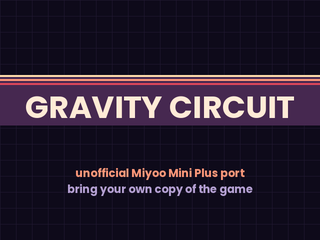

# Gravity Circuit for Miyoo Mini Plus (OnionOS)



An unofficial port of [Gravity Circuit](https://gravitycircuit.com), the action
platformer by Domesticated Ant Games, to the Miyoo Mini Plus running OnionOS.

**This port does not include the game.** It plays your own copy, which you need
to buy (Steam, itch.io or another store). The download contains only the port
code and the LÖVE engine it runs on.

This port is not made, endorsed or supported by Domesticated Ant Games. Please
report problems here, in [Issues](https://github.com/snyderman3000/gravitycircuit-onionOS/issues),
not to them.

The port was written by Claude (Anthropic's AI) for
[snyderman3000](https://github.com/snyderman3000), who tested it on the device.

## Status

Version 0.1.6. Mostly playable from start to finish, with some frame rate
drops in busier scenes. The handheld has no GPU, so the game is drawn in
software, which is why it isn't a locked 60 FPS.

## What you need

- A Miyoo Mini Plus with OnionOS
- OnionOS's **Ports** system: Package Manager > Verified > Ports
- About **700 MB free** on the SD card: about 400 MB for the copied game, a
  256 MB swap file, and room for the game file while it is being copied
- **One file from your own copy of Gravity Circuit** (see below)

## The file you need to add

You need **one** of these two files. Either one works; you don't need both.

| Your copy of the game | File to copy | Where to find it |
|---|---|---|
| Windows (Steam, itch.io, etc.) | `GravityCircuit.exe` | In the game's install folder. On Steam: right-click Gravity Circuit > Manage > Browse local files. |
| Linux (the `.AppImage`) | `GravityCircuit` (no file extension, about 310 MB) | Inside the AppImage. See [Getting the file out of the AppImage](#getting-the-file-out-of-the-appimage). |

Put the file in this folder on the SD card:

```
Roms/PORTS/Games/GravityCircuit/
```

Keep the file's name exactly as it is. The finished layout looks like this:

```
SD card
└── Roms
    └── PORTS
        ├── Games
        │   └── GravityCircuit
        │       ├── GravityCircuit.exe   ← your file goes here
        │       ├── launch.sh
        │       ├── game/
        │       ├── lib/
        │       └── ...
        ├── Imgs
        └── Shortcuts
```

### Getting the file out of the AppImage

The AppImage itself won't work; the program inside it does. On Linux, in a
terminal in the folder with the AppImage:

```
chmod +x GravityCircuit.AppImage
./GravityCircuit.AppImage --appimage-extract
```

This makes a `squashfs-root` folder. Copy `squashfs-root/bin/GravityCircuit`
into `Roms/PORTS/Games/GravityCircuit/` on the SD card.

## Install

### With Mixtape

1. Open [Mixtape](https://github.com/snyderman3000/mixtape), find Gravity
   Circuit and install it.
2. Turn the handheld off, put the SD card in your computer and copy your game
   file into `Roms/PORTS/Games/GravityCircuit/` (see above). You can also copy
   it over Wi-Fi with OnionOS's file sharing.
3. Launch Gravity Circuit from Games > Ports.

### By hand

1. Download `GravityCircuit-miyoo-v0.1.6.zip` from
   [Releases](https://github.com/snyderman3000/gravitycircuit-onionOS/releases).
2. Unzip it and copy the `Roms` folder to the root of the SD card. It merges
   with the `Roms` folder that's already there.
3. Copy your game file into `Roms/PORTS/Games/GravityCircuit/` (see above).
4. Launch Gravity Circuit from Games > Ports. If it isn't listed, run
   "~Import ports" from the Ports list.

### First start

The first start copies the game out of your file (a few minutes, with a
progress screen) and makes the swap file. Leave it running until the game
starts. Starts after that skip this step.

Once the game has started once, you can delete `GravityCircuit.exe` (or
`GravityCircuit`) from the SD card to free about 300 MB. Keep a copy on your
computer: a future port update may ask you to put it back ("This update needs
the game's original files"). Your copy of the game is never changed.

## Controls

The game's default controller layout. Buttons shown in the game use the letters
printed on the Miyoo.

| Button | Action |
|---|---|
| D-pad | Move |
| B | Jump |
| Y | Attack |
| R2 | Hookshot |
| R1 | Burst / special |
| L2 | Run |
| Start | Pause / menu |
| Select + Start, or Menu + Start | Quit |

Everything can be changed in the game's own control settings.

## Saves, logs and updates

- Saves and settings: `Roms/PORTS/Games/GravityCircuit/data/`. Updates, by
  hand or with Mixtape, leave this folder alone.
- Log of the last run: `Roms/PORTS/Games/GravityCircuit/log.txt`. Please
  attach it to bug reports.

## Troubleshooting

- **"Gravity Circuit's game files weren't found":** check the file is
  directly in `Roms/PORTS/Games/GravityCircuit/` (not in a subfolder) and is
  named `GravityCircuit.exe` or `GravityCircuit`.
- **"...card full?":** free up space; the first start needs about 700 MB.
- **"This version of the game isn't supported yet":** the port
  makes small edits to the game's code while copying it, and a game update
  changed that code. Open an issue with your log.txt and the game version.
- **Not in the Ports list:** install the Ports system from Package Manager >
  Verified, then run "~Import ports" from the Ports list.

## What the port changes

The game runs on LÖVE 11.5 with a software renderer. To fit in the handheld's
128 MB of memory and run at a playable speed, the port makes a few small edits
to the copied game code: Steam achievements are off, music is streamed instead
of decoded into memory, tile graphics are prepared when first used, images are
stored with 8-bit colour palettes, the player's scarf uses a faster particle
effect, and the on-screen button icons default to the Nintendo-style set.
Sound effects are stored at a lower sample rate in mono.

## Licenses

The port's own code is MIT licensed (see [LICENSE](LICENSE)). The release zip
also contains LÖVE and other libraries under their own licenses, listed in
[THIRD_PARTY_NOTICES.md](THIRD_PARTY_NOTICES.md). Gravity Circuit itself is
© Domesticated Ant Games and is not included.
